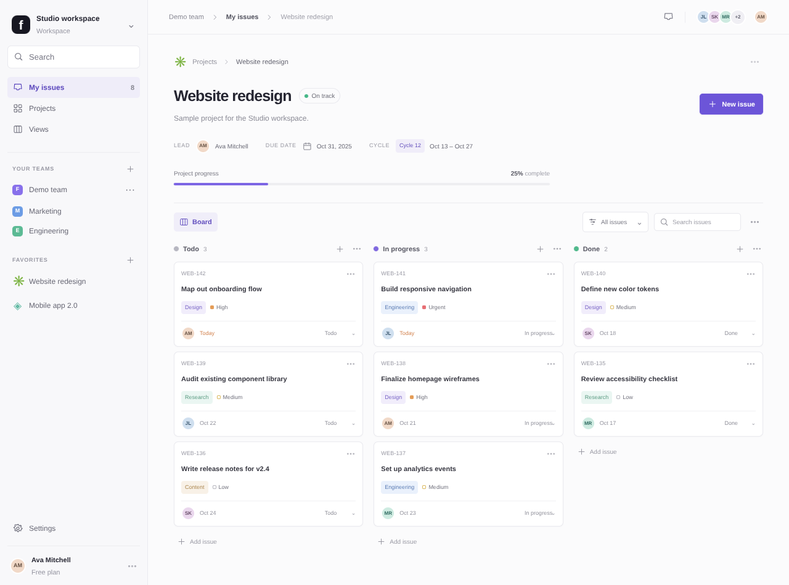

# CollabFlow

CollabFlow is a frontend issue-board prototype built with Next.js, React, TypeScript, and Tailwind CSS. Create an issue, find it using search or a status filter, then move it to Done to see project progress update.



## Run locally

Use Node.js 24 and npm. The demo uses bundled data and requires no credentials.

```bash
git clone https://github.com/Kylin-Ace/collabflow.git
cd collabflow
npm ci
npm run dev
```

Open [localhost:3000](http://localhost:3000). Select **New issue**, give it a title, and find it in the Todo column. Change its status to **Done** and watch the progress indicator update.

The board uses in-memory state. Changes reset on refresh. The prototype has no accounts, shared workspace, or database.

Run `npm run lint` and `npm run build` to verify the project. The board and issue state live in [src/app/page.tsx](src/app/page.tsx).
